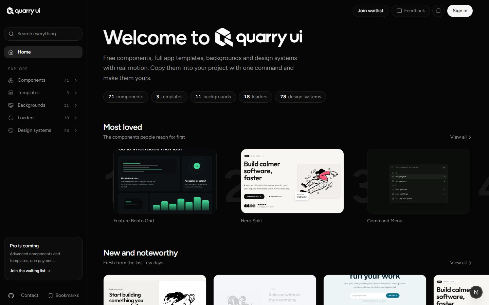
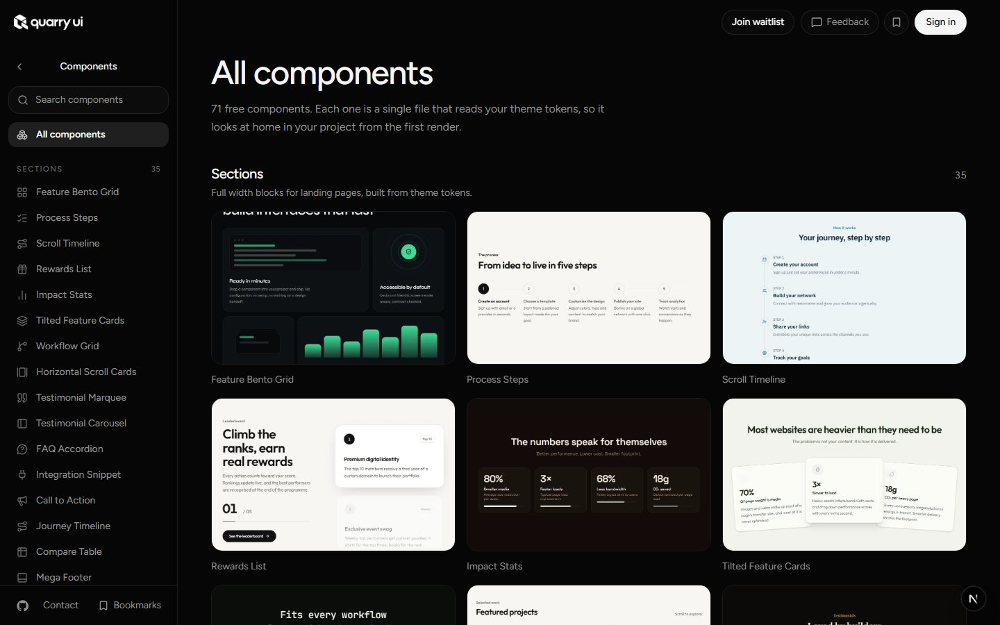
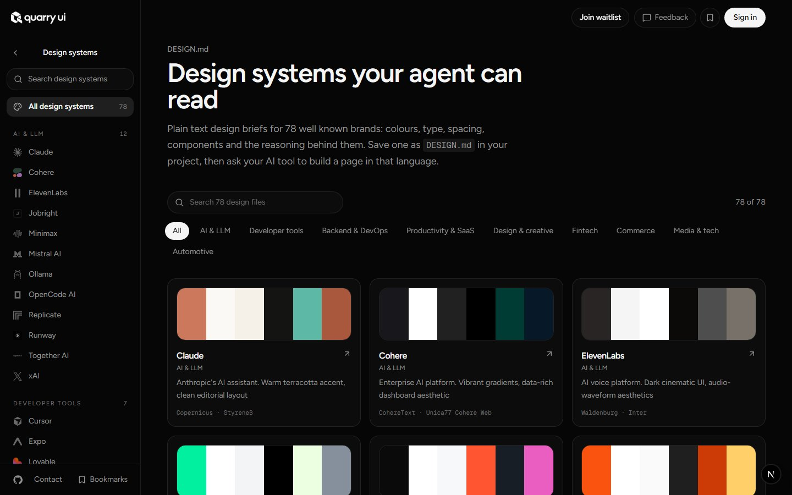

<p align="center">
  <a href="https://quarry-ui.vercel.app">
    <picture>
      <source media="(prefers-color-scheme: dark)" srcset=".github/assets/logo-light.png">
      
    </picture>
  </a>
</p>

<p align="center">
  Free React components and full app templates, with real motion.<br>
  Copy one into your project with a single command. It is your code from then on.
</p>

<p align="center">
  <a href="LICENSE"></a>
  <a href="CONTRIBUTING.md"></a>
  
</p>

<p align="center">
  
</p>

## Install something

```bash
npx shadcn@latest add https://quarry-ui.vercel.app/r/mega-footer.json
```

That copies the file into your project. Then use it:

```tsx
import { MegaFooter } from "@/components/mega-footer";

export default function Page() {
  return <MegaFooter brand="Northwind" />;
}
```

You need a React project with Tailwind and shadcn/ui. If you have not set shadcn up yet, run `npx shadcn@latest init` once first.

Read the [documentation](https://quarry-ui.vercel.app/docs/introduction) for the full guide, or grab the [PDF](https://quarry-ui.vercel.app/quarry-ui-documentation.pdf).

Prefer an AI tool? Open any component on the site, press **Copy prompt**, and paste it into Claude Code, Cursor, v0 or whatever you use.

## What is in it

| | |
|---|---|
| **Components** | Sections and elements: footers, pricing, testimonials, navbars, galleries, video, forms and more |
| **Templates** | Whole apps you install and make your own: AI Chat, File Manager, Learning Platform, Abyss |
| **Backgrounds** | Live canvases with controls: starfield, square grid, topo lines, dot globe, an ASCII aquarium of sharks, birds and pets, an ASCII lagoon |
| **Loaders** | Small loading motions |
| **Design systems** | DESIGN.md briefs for 78 well known brands, to hand to your AI tool |

<p align="center">
  
  
</p>

## A few rules we keep

- **Your theme, not ours.** Components only use shadcn tokens, so they match your colours and dark mode.
- **One file each.** Open it and you can read the whole thing.
- **Motion that explains.** Things move to show what changed, never just to show off.

## Run it locally

```bash
git clone https://github.com/PRODHOSH/quarry-ui.git
cd quarry-ui
npm install
npm run dev
```

Open [localhost:3000](http://localhost:3000). Sign in and bookmarks need a free [Supabase](https://supabase.com) project. Copy `.env.example` to `.env.local`, fill in the two keys, and run the files in `supabase/migrations` in order. The site works without it.

## Add a component

1. Create `registry/quarry/<name>.tsx` with a named export and a `className` prop.
2. Add it to `registry.json` and give it a preview in `registry/demos.tsx`.
3. Run `npm run registry:build`, then `node scripts/make-thumbs.mjs <name>` for its thumbnail.

The full checklist is in [CONTRIBUTING.md](CONTRIBUTING.md).

## Roadmap

- [x] Components, backgrounds, loaders and four templates
- [x] Copy prompts for the major AI tools
- [ ] MCP server so agents can install components directly
- [ ] More templates: landing page, portfolio, blog
- [ ] Pro collection

## Contributing

Pull requests are welcome, from a typo to a whole new component. Read [CONTRIBUTING.md](CONTRIBUTING.md) first. Found a security issue? Please see [SECURITY.md](SECURITY.md) instead of opening a public issue.

## License

[MIT](LICENSE). Use it anywhere, no credit needed. Third party credits are in [THIRD_PARTY_NOTICES.md](THIRD_PARTY_NOTICES.md).
